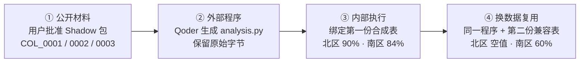

# 析间 Xijian

析间是本地优先的双域 Agent 分析工作台。你先决定内侧模型可以看到哪些字段，再批准发给外侧 Coding Agent 的公共材料。外侧返回 Python 程序，析间在本机执行原程序，并可将同一程序用于另一份兼容的数据。

**当前版本为 0.4.0-dev.4，供受信任的 Windows 单机使用合成数据试用。** [下载 Windows x64 预发行包](https://github.com/kevin1000x/xijian/releases/tag/v0.4.0-dev.4) · [发布说明](RELEASE.md) · [MIT 许可证](LICENSE)

## 用两张合成表试用

完整解压 Windows 附件 `Xijian-0.4.0-dev.4-windows-x64-trial.zip`，保留目录结构，双击 `Xijian/Xijian.exe`。运行环境为 Windows 10/11 x64 和 Microsoft Edge WebView2 Runtime。桌面包自带 Python 运行时，程序尚未签名。第三方材料见包内 `THIRD-PARTY-NOTICES.txt` 与 `licenses/`。

1. 导入包内 `field-a.csv`。该表含比例、金额、分组三列。配置你获准使用的内侧模型 API 或 MCP 宿主，以及外侧程序生成路线。使用账户前确认数据范围和费用预算。MCP 模式还需连接宿主并授权当前输入。
2. 填写“只计算 trial_amount_x 的总和”，在**提案前**只选金额列 `trial_amount_x`，核对内侧接收方。默认传送任务原文、所选列的名称与类型，行值和执行结果行的授权均关闭。若需样例，另选样例字段及行号，只有对应的单元格会随提案发给内侧。持久 MCP 宿主跨任务使用样例或结果行需要单独同意。
3. 在公开批准页核对外侧接收方、字段用途与公共 JSON。此任务的外侧材料应只有一个不透明整数字段与独立生成的合成样例。确认后开始协作，检查公开样例，再在本机执行。
4. 首次金额合计应为 **13**（5 + 8）。导入只含金额列的 `field-b.csv`，选择原任务并复用程序，合计应为 **6**（2 + 4）。两次候选程序的 SHA-256 应一致。关闭重开后，从历史任务找回两次结果。

本版从最终 Windows ZIP 解压后，用本机回环模型替身走通了上述流程。捕获的内侧默认请求中有 0 行值，显式授权一个单元格时收到了 1 个单元格。公开样例、首次执行、换表复用的三份回执使用同一隔离策略。独立试用者在干净 Windows 机器上的验收仍待安排。

## 无模型账户的本地示例

另从公开仓库下载 example-a.csv、example-b.csv。这两份 CSV 均为 5 行虚构数据，字段为 `region`、`revenue`、`cost`。把 A、B 当作两个期间，先保存按地区计算净额的口径，再应用于 B，就能观察收入和成本变化后的结果。

1. 点击「选择文件」，导入 [example-a.csv](example-a.csv)。
2. 展开「高级编辑 · 本地规则工具」，选择「分类净额」。核对按 `region` 分组，分别汇总 `revenue` 和 `cost`，净额为收入合计减成本合计。
3. 点击「查看分析口径」→「确认并运行」，查看「表格」「图表」或「导出 CSV」。
4. 为方案命名并「保存方案」。导入 [example-b.csv](example-b.csv)，从「我的分析方案」选择刚保存的方案，核对口径后再次运行。

| 地区 | A 收入合计 | A 成本合计 | A 净额 | B 收入合计 | B 成本合计 | B 净额 |
| --- | ---: | ---: | ---: | ---: | ---: | ---: |
| East | 150 | 70 | 80 | 200 | 120 | 80 |
| North | 260 | 110 | 150 | 290 | 120 | 170 |
| South | 190 | 90 | 100 | 280 | 135 | 145 |

North 净额增加 20，South 增加 45，East 不变。以上是示例的预期算术结果。界面“已执行 · 数值未经独立认证”表示程序已经运行，尚未获得独立数值认证。

这套操作无需模型账户。「保存方案」复用本地分析口径。「用当前数据复用此程序」则需要已有获准的外部生成程序及兼容的新表。首次安装没有历史外部程序，两种复用入口的前提不同。

## 执行与记录

每次新候选运行都使用专属的标准 Windows AppContainer 身份、零额外能力与单进程 Job。隔离建立失败时停止执行。标准 AppContainer 可读取系统或软件明确授权给所有应用包的公共资源。本机合成对照中，容器拒绝读取任务目录外的测试标记，也拒绝连接同一个可由普通进程访问的本机监听端口。网络拒绝的实测范围为本机回环。

本地记录默认保存在 `%LOCALAPPDATA%/Xijian/desktop-v1`。升级替换程序目录时保留用户数据目录。重开后需重新配置 HTTP 凭据，MCP 授权由本机 DPAPI 保护并可撤销。外侧交付状态未知时，保留原记录，刷新或查询原任务。远程节点设置见[使用指南](docs/remote-agent-nodes.md)。

本地服务绑定回环地址。同机原生客户端仍可能访问读取接口与启动信息。按用户和任务控制访问、数据保留与删除，以及真实敏感数据试点仍待单独验收。当前仅限合成数据。

## 历史演示 · 按地区计算准时发货率

**按区域计算准时发货率。** 内侧口径为「（发货总量 − 延误总量）÷ 发货总量」，分母为零时返回空值。下面整理自 **2026-09-11 的真实合成数据记录**。

当时使用 **0.3.0-alpha.2**。内侧 Codex CLI 经 MCP 提交方案与解读，外侧 Qoder SDK 使用 `gfmodel`。



*这是按留存记录整理的流程图。首次执行前曾因恢复读取锁冲突阻塞，修复后由 GUI 明确继续已有候选。*

| 看哪一步 | 实际发生了什么 | 可查看的材料 |
| --- | --- | --- |
| 公开材料 | 将分组、求和、比率及零分母规则写入抽象任务，字段使用 `COL_*`，附独立合成示例 | [实际交给外侧的公开包](demo/public-bundle.json) |
| 外部程序 | 留存回执记录一次 Qoder SDK query，返回定义 `analyze(df)` 的程序 | [Qoder 原始 analysis.py](demo/analysis.py) |
| 内部执行 | 原程序在本机绑定第一份合成表，返回北区 `0.9`、南区 `0.84`，随后由内侧解读 | [首次运行与解读记录](demo/results.json) |
| 换表复用 | GUI 使用第二份兼容合成表复用同一程序，返回北区 `null`、南区 `0.6` | [复用运行及程序摘要](demo/results.json) |

两次运行、任务保存副本和执行账本中的程序，均与外侧原文件逐字节一致，SHA256 为 `1ae2139d437c2cece35ce51489f6d61d4bfd142c11a2631b5c080bbc3a736ec0`。

结果保留 `EXECUTED_UNVERIFIED` / `NOT_EVALUATED` 状态，首次解读后任务为 `INTERPRETED_UNVERIFIED`。这两份合成输入有算术比对。表中记录为可公开摘录，供应商底层请求总数未经独立清点。

## 源码与开发

公开源码、测试与示例的文件清单见 [source-allowlist.json](source-allowlist.json)。项目源码采用 MIT 许可证，第三方组件适用各自许可。

已验证的开发环境为 Windows x64、Python 3.8.5、NumPy 1.24.4、pandas 2.0.3、openpyxl 3.1.5 和 pytest 7.4.4。桌面窗口还需要 pywebview 6.2.1、pythonnet 3.0.5、clr_loader 0.2.10 及其依赖，以及 Edge WebView2 Runtime。源码模式下，新候选执行另依赖指定 dev.3 Windows 发行运行时及匹配的清单。该依赖不随源码 ZIP 提供。需要直接试用隔离执行时，请使用本版自带运行时的 Windows 包。

在上述环境中，可从仓库根目录启动桌面窗口或浏览器界面，用独立目录保留开发记录。

```powershell
python -B desktop_app.py --state "$env:LOCALAPPDATA/Xijian/source-dev4"
python -B -m tools.workbench_server --state "$env:LOCALAPPDATA/Xijian/source-web-dev4" --open-browser
```

构建配置见 `desktop/workbench.spec`、`desktop/requirements-build.txt` 和 `tools/package_workbench.ps1`。构建需要已准备的数值库和正式 VC 运行库。

## 反馈

请附应用与 Windows 版本、所用连接路线、出错前一步、预期与实际结果，以及重开后是否仍出现。可以附可公开的合成示例。请保留密钥、账户配置、个人及业务数据和整个用户工作区在本机。[提交 GitHub Issue](https://github.com/kevin1000x/xijian/issues)
