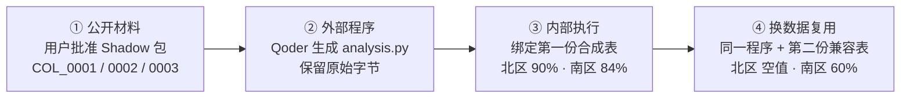

# 析间 Xijian

**本地优先的双域 Agent 协作工作台。**

析间通过内侧模型 API 或 MCP 宿主组织任务，将用户批准的 Shadow 公共材料交给外侧 Coding Agent，接收生成的程序并在本机执行、查看结果与复用。

当前版本为 **0.3.0-alpha.5**，面向受信任单机环境中的合成数据体验。项目提供无需模型账户的本地示例，方便先了解数据导入、结果展示和方案复用。

[Windows Alpha 下载](https://github.com/kevin1000x/xijian/releases/tag/v0.3.0-alpha.5) · [问题反馈](https://github.com/kevin1000x/xijian/issues) · [MIT 许可证](LICENSE)

## 真实演示：生成一次，换表复用

**任务：按区域计算准时发货率。** 内侧口径为「（发货总量 − 延误总量）÷ 发货总量」，分母为零时返回空值。下面整理自 **2026-09-11 的真实合成数据记录**。

**实际模式与版本：** 内侧为 Codex CLI 经 MCP 提交方案与解读，外侧为 Qoder SDK（配置模型 `gfmodel`）；演示服务版本为 **0.3.0-alpha.2**。当前下载是 **0.3.0-alpha.5**，这段历史演示不代表 Alpha.5 新跑了一次完整双域流程。本次展示整理没有新增模型调用。



*这是按留存记录整理的流程图。首次执行前曾因恢复读取锁冲突阻塞，修复后由 GUI 明确继续已有候选；上述流程包含这次人工接续。*

| 看哪一步 | 实际发生了什么 | 可查看的材料 |
| --- | --- | --- |
| 公开材料 | 将分组、求和、比率及零分母规则写入抽象任务；字段使用 `COL_*`，附独立合成示例 | [实际交给外侧的公开包](demo/public-bundle.json) |
| 外部程序 | 留存回执记录一次 Qoder SDK query，返回定义 `analyze(df)` 的程序 | [Qoder 原始 analysis.py](demo/analysis.py) |
| 内部执行 | 原程序在本机绑定第一份合成表，返回北区 `0.9`、南区 `0.84`，随后由内侧解读 | [首次运行与解读记录](demo/results.json) |
| 换表复用 | GUI 使用第二份兼容合成表复用同一程序，返回北区 `null`、南区 `0.6` | [复用运行及程序摘要](demo/results.json) |

两次运行、任务保存副本和执行账本中的程序，均与外侧原文件逐字节一致，SHA256 为 `1ae2139d437c2cece35ce51489f6d61d4bfd142c11a2631b5c080bbc3a736ec0`。

结果保留 `EXECUTED_UNVERIFIED` / `NOT_EVALUATED` 状态，首次解读后任务为 `INTERPRETED_UNVERIFIED`。已有算术比对支持这两份输入；不据此宣称所有输入正确、原标签排序普遍成立或生产隐私隔离已认证。记录是人工整理的公开摘录，未附完整内部输入与工作区；一次 SDK query 也不等于已独立清点供应商全部底层请求。

## 开始使用

使用 `Xijian-0.3.0-alpha.5-feedback.2.zip`，完整解压后双击 `Xijian/Xijian.exe`。保留整个目录，无需另装 Python。要求 Windows 10/11 x64，且已安装 Microsoft Edge WebView2 Runtime。反馈包包含两份示例、反馈表和第三方许可材料。

运行前阅读随包 `THIRD-PARTY-NOTICES.txt` 与 `licenses/` 并确认适用条款；Microsoft 运行库仅随本应用使用。启动被拦截或报错时记录原始提示，不必关闭安全软件。程序尚未签名。

## 快速体验：无需模型账户

两份 CSV 均为 5 行虚构数据，字段为 `region`、`revenue`、`cost`。把 A、B 当作两个期间，先保存按地区计算净额的口径，再应用于 B，就能观察收入和成本变化后的结果。

1. 点击「选择文件」，导入 [example-a.csv](example-a.csv)。
2. 展开「高级编辑 · 本地规则工具」，选择「分类净额」。核对按 `region` 分组，分别汇总 `revenue` 和 `cost`，净额为收入合计减成本合计。
3. 点击「查看分析口径」→「确认并运行」，查看「表格」「图表」或「导出 CSV」。
4. 为方案命名并「保存方案」。导入 [example-b.csv](example-b.csv)，从「我的分析方案」选择刚保存的方案，核对口径后再次运行。

| 地区 | A 收入合计 | A 成本合计 | A 净额 | B 收入合计 | B 成本合计 | B 净额 |
| --- | ---: | ---: | ---: | ---: | ---: | ---: |
| East | 150 | 70 | 80 | 200 | 120 | 80 |
| North | 260 | 110 | 150 | 290 | 120 | 170 |
| South | 190 | 90 | 100 | 280 | 135 | 145 |

North 净额增加 20，South 增加 45，East 不变。以上是示例的预期算术结果；界面“已执行 · 数值未经独立认证”表示程序已经运行，尚未获得独立数值认证。

这套操作无需模型账户。「保存方案」复用本地分析口径；「用当前数据复用此程序」则需要已有获准的外部生成程序及兼容的新表。首次安装没有历史外部程序，两种复用入口的前提不同。

## 核心流程：双域 Agent 协作（需配置模型或 Agent）

完整流程需要用户自己的内部模型 API 或支持 MCP 的宿主 Agent，以及 Qoder 安装、CLI 登录和明确的账户、费用授权。桌面包不含 Qoder、SDK、账户、凭据或历史候选程序。已观察的 Qoder 组合为 CN 0.2.3 所带 SDK 1.0.37 / worker 1.1.47、CLI 1.1.49；其他版本尚未验收，外部 HTTP 接口仅有本地替身检查。

在「配置内部 Agent 与外部 Qoder」设置自己的连接：API 路线使用「应用内部连接」；MCP 路线先「连接内部 Agent」，导入合成输入后「授权使用当前输入」，在宿主 Agent 提出任务。Qoder 使用「连接 Qoder 并核对模型目录」。连接配置完成不代表宿主已在线，应用不会自动唤醒 MCP 宿主。

可提出“按 region 汇总 revenue 和 cost，并计算两者差额”。查看公开材料后，再决定是否「批准这些材料并开始协作」。原始任务、列名和输入数据会提供给所选内侧路线；外侧应仅收到已批准的公开包。程序在本机执行，结果由内侧解释。没有账户或预算时，直接使用前述本地示例即可。

## 本机记录与使用边界

记录默认保存在 `%LOCALAPPDATA%/Xijian/desktop-v1`。关闭窗口会停止它拥有的后台进程，保留任务、程序、结果和取消记录。重开后 HTTP 凭据需重配；MCP 授权由本机 DPAPI 保护，可在界面撤销。升级替换程序目录时保留用户数据目录。

操作状态未知时保留原记录，不重复发送；刷新仅读取状态，取消不能撤销已经产生的供应商费用。账本余额并非供应商实际剩余额度，新建工作区也不产生新的费用授权。

本地服务绑定回环地址，并检查 Host、Origin 与 Sec-Fetch-Site；写入请求有 CSRF 检查，MCP 使用独立令牌。同机原生客户端仍可访问读取接口和启动信息，因此当前仅用于受信任单机的合成数据，不接收真实业务或个人数据，也未完成生产隐私隔离认证。

2026-09-12 已收到一次用户报告：在另一台 Windows 电脑正常运行，关闭重开并找回记录，评价“可以正常使用”。这支持一次离线跨机体验；具体系统版本、硬件、干净安装条件和接收方包摘要未独立核验。该反馈没有新增完整双域或普遍用户价值结论。

## 源码与开发者入口

仓库直接提供源码、相关合成测试和示例；当前主分支文件范围见 [source-allowlist.json](source-allowlist.json)，发布对应关系见 [RELEASE.md](RELEASE.md)。项目源码采用 [MIT](LICENSE)，第三方组件仍适用各自许可证。

已验证环境为 Windows x64、Python 3.8.5、NumPy 1.24.4、pandas 2.0.3、openpyxl 3.1.5；桌面入口还需要 pywebview 6.2.1、pythonnet 3.0.5、clr_loader 0.2.10 及其依赖，以及已安装的 Edge WebView2 Runtime。测试使用 pytest 7.4.4。这里列出既有环境，不要求升级或修改历史实验环境，也不是全新机器的一键环境锁定。

在已具备上述依赖的环境中，从仓库根目录启动，使用独立的本地状态目录：

```powershell
python -B desktop_app.py --state "$env:LOCALAPPDATA/Xijian/source-alpha5"
```

也可启动浏览器界面（此入口不需要 pywebview 窗口）：

```powershell
python -B -m tools.workbench_server --state "$env:LOCALAPPDATA/Xijian/source-web-alpha5" --open-browser
```

以下是已有合成检查入口，不调用真实模型：

```powershell
python -B -m pytest -q tests/test_workbench_server.py::test_localhost_host_origin_and_csrf tests/test_workbench_server.py::test_scoped_mcp_cannot_publish_or_read_other_task
```

构建配置见 `desktop/workbench.spec`、`desktop/requirements-build.txt` 和 `tools/package_workbench.ps1`。构建还依赖准备好的数值库及正式 VC 运行库来源；本次没有重编译桌面程序，也未证明从任意新环境逐字节生成同一个 EXE。

## 遇到问题

请在 [GitHub Issues](https://github.com/kevin1000x/xijian/issues) 提供：应用版本、Windows 版本、使用本地规则/API/MCP 的哪条路径、出错前一步、预期和实际表现、关闭重开后的情况。反馈包中的 `FEEDBACK.md` 可直接填写。

可以附合成示例的错误提示或结果截图；请勿发送密钥、账户配置、个人/业务数据或整个用户工作区。缺少账户、MCP 宿主未接续、版本不匹配和预算不足，都可作为具体卡点反馈。
